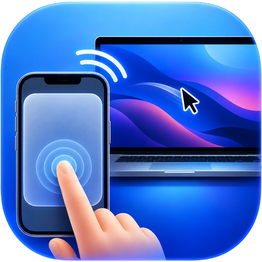

#  BlanketCozzy - TrackPad

A lightweight, zero-latency Wi-Fi trackpad app that turns your phone into a full-featured trackpad for your laptop (Mac or Windows). *Your Mac & PC, comfortably in control.* Perfect for cozy bed & blanket sessions where reaching for the physical trackpad is uncomfortable.

---

## ⚡ Features
- **Zero Latency**: Direct local TCP connection with `TCP_NODELAY` (no packet buffering delay).
- **Smooth Cursor Dynamics**: Non-linear acceleration curve so slow touches give pixel precision and quick swipes traverse multiple monitors.
- **Natural Trackpad Gestures**:
  - **1 Finger Move**: Cursor navigation
  - **1 Finger Tap**: Left click (with subtle haptic feedback)
  - **2 Finger Swipe**: Smooth 2D scrolling (up/down/left/right)
  - **2 Finger Tap**: Right click
  - **Hold & Drag**: Click-and-drag windows or select text
- **🛌 Blanket Mode Special**:
  - **Volume Up**: Instant Left Click
  - **Volume Down**: Instant Right Click
  *(Click effortlessly without even having to look at your phone screen!)*
- **Cross-Platform**: Works on both macOS and Windows.
- **Remote Typing**: Tap ⌨️ to send text, Backspace, or Enter straight to your computer.

---

## 🚀 Setup Guide

### 1. Run Desktop Server (Mac or Windows)

Navigate to the `server/` directory:
```bash
cd server
python3 server.py
```

The script uses native OS APIs (zero pip dependencies needed) and will print your server address (e.g., `10.57.158.54:8765`).

#### 🍏 macOS Permission Notice:
macOS requires Accessibility permissions for any script controlling the cursor:
1. Open **System Settings** -> **Privacy & Security** -> **Accessibility**.
2. Make sure your **Terminal** (or iTerm / VS Code / Python) is toggled **ON**.

#### 🪟 Windows Notice:
If Windows Firewall prompts you on first run, click **Allow access for Private Networks**.

---

### 2. Build & Run Android App

1. Open the `android/` directory in **Android Studio**.
2. Connect your phone or emulator and click **Run** (Green play button).
3. In the app:
   - Paste the printed server address (e.g., `10.57.158.54:8765`).
   - Tap **Connect**.
4. You're done! Enjoy full trackpad control from under your blanket.
